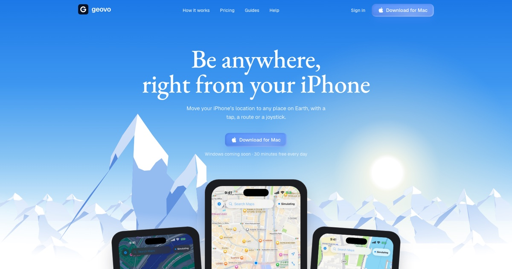
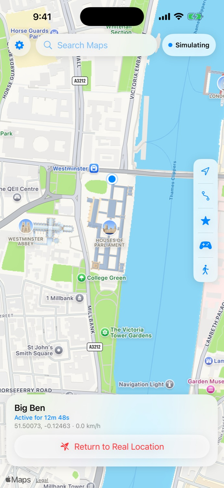
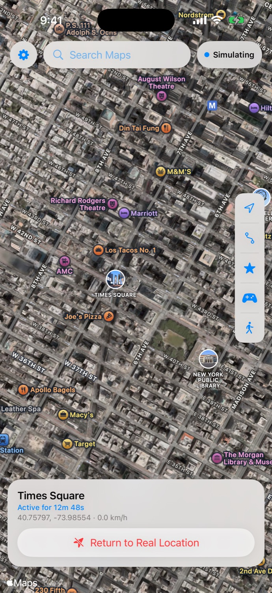
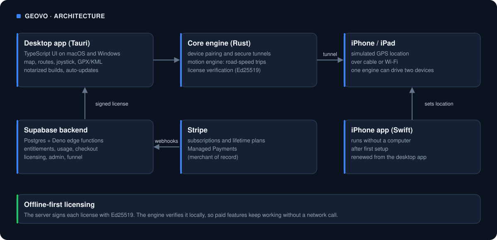

# Geovo

**Change your iPhone's location from a Mac, a Windows PC or the iPhone itself. No jailbreak.**

**Live:** [geovo.app](https://geovo.app) &nbsp;|&nbsp; **Status: live product with paid plans** &nbsp;|&nbsp; [Downloads](https://github.com/aomine97/geovo-releases)

---

## What it does

Geovo sets an iPhone's GPS location for app testing, demos, previews of other cities and travel planning. Teleport by tapping the map or searching, drive there along real roads at car speed, follow walking, cycling or driving routes, use a joystick, or import GPX and KML. It works over the cable or Wi-Fi from a computer, and from the iPhone alone with no computer plugged in. Return to your real location at any time; locations never leave your devices.

| London | Paris | New York |
|---|---|---|
|  |  |  |

Plans: a free 15-minute trial, then Pro weekly, monthly, quarterly, yearly or lifetime. English, Spanish and Portuguese.

---

## Results

As of November 2026, about six weeks after launch:

| Users | Paying customers | Monthly recurring revenue |
|---|---|---|
| 218 | 60 | $837 |

Growth came mostly from SEO pages, plus referrals and a creator program.

---

## How it's built

| Layer | Technology |
|---|---|
| Core engine | Rust: device pairing and tunnels, location simulation, routes and road-speed trips, licensing |
| Desktop apps | Tauri (Rust + TypeScript) for macOS (Apple Silicon and Intel, notarized) and Windows, with auto-updates |
| iPhone app | Swift, installed with the user's own Apple ID, renewed automatically from the computer |
| Backend | Supabase Postgres and Deno edge functions (entitlements, usage, checkout, licensing, admin, funnel) |
| Payments | Stripe with Managed Payments (Stripe as merchant of record) |
| Website | TanStack Start + React + Tailwind on Vercel, SEO pages with JSON-LD, sitemap and IndexNow |
| Ops | Own admin console: funnel, retention, reliability, failures, cancellations, campaigns; no third-party analytics |

### Engineering details worth a look

- **Simulation over Wi-Fi** using the same pairing records the phone already trusts, with the cable preferred when plugged in.
- **24-hour reliability work on iPhone:** fast reconnects, restore after relaunch, a connection log, and opt-in daily connection stats.
- **Team and QA mode:** one motion engine moves two iPhones or iPads together.
- **Privacy by design:** no analytics or tracking pixels; hashed install IDs only.

---

*Geovo is closed source. This repository is a public overview.*
